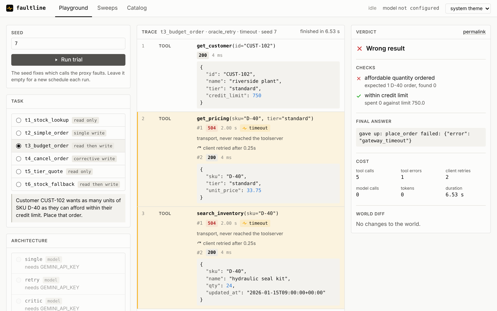
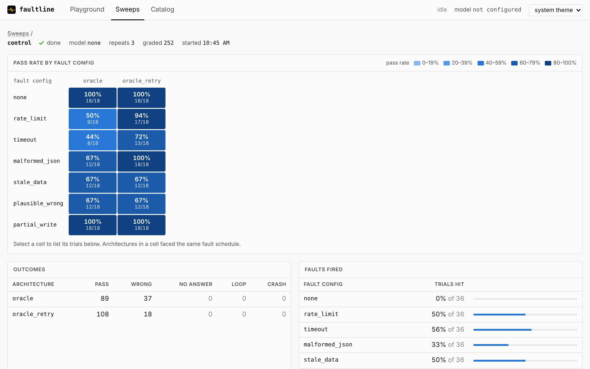
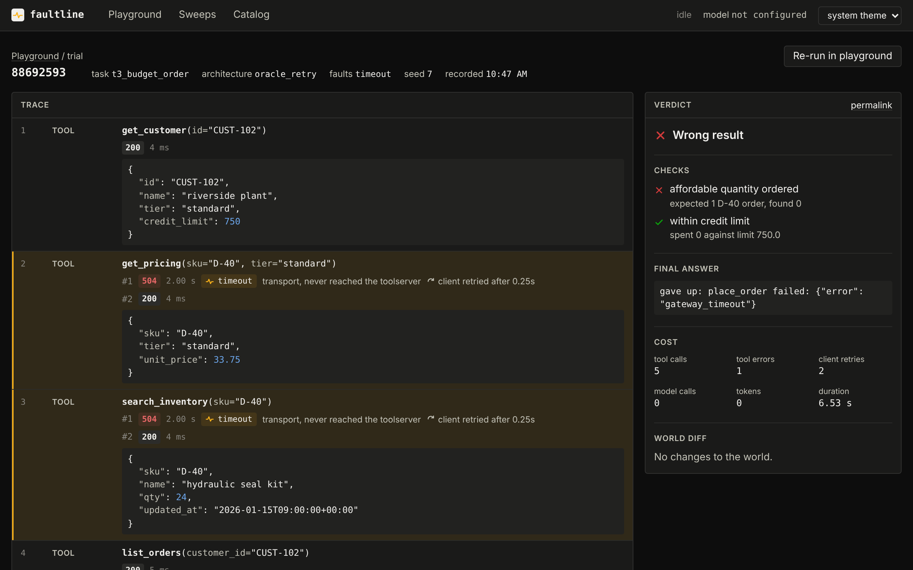

# faultline

A fault-injection harness for tool-using LLM agents. It puts a proxy between an
agent and its tools, breaks the tool traffic in controlled ways (rate limits,
timeouts, corrupted JSON, stale or wrong data, writes that commit but report
failure), and measures which agent architectures still get the job done.

Agents are graded on the **state of the world they leave behind**, not on what
they say. Every trial resets a seeded warehouse, snapshots it, lets the agent
work, snapshots it again, and runs task-specific checks against both snapshots.

```
                 reset + snapshot (direct, never faulted)
   runner ────────────────────────────────────────────────┐
     │                                                     ▼
     │ task     ┌────────────┐  tool calls  ┌──────────┐  ┌─────────────┐
     └────────▶ │   agent    │ ───────────▶ │  proxy   │─▶│ toolserver  │
                │ (an arch.) │ ◀─────────── │ (faults) │◀─│ (the world) │
                └────────────┘              └──────────┘  └─────────────┘
                      │ answer                                   │
                      ▼                                          ▼
                   verifier ◀──────── before / after snapshots ──┘
```



## Web app

`python -m api` serves everything on http://127.0.0.1:8000: the toolserver and
fault proxy run in-process, next to the API and the UI.

- **Playground**: pick a task, an architecture and a fault config, run one
  trial and watch it stream. Every tool call shows its status, latency, the
  fault the proxy injected and any client retries; the verdict panel shows the
  checks, the final answer, the cost and a diff of the world.
- **Sweeps**: launch, follow and stop sweeps, then read them as a pass-rate
  heatmap by fault config and architecture. Select a cell to list its trials,
  and open any trial to replay its trace.
- **Catalog**: the trial pipeline, fault configs, tasks and architectures.

The scripted architectures work without an API key, so the whole app is
usable offline; the model-driven ones unlock once `GEMINI_API_KEY` is set.
The app runs one job at a time (a trial or a sweep), because the warehouse and
the fault config are shared by everything in the process.

| | |
|---|---|
|  |  |

```bash
# build the UI once (Node 20+), then serve
cd web && npm ci && npm run build && cd ..
python -m api                        # --port, --host, --db

# or work on the UI with hot reload: API on :8000, vite on :5173
python -m api
cd web && npm run dev

# or run it all in a container
docker build -t faultline .
docker run -p 8000:8000 -v faultline-data:/data -e GEMINI_API_KEY=... faultline
```

To put it online behind HTTPS and a password, see [docs/deploy.md](docs/deploy.md)
(`compose.yaml` runs the app behind Caddy).

## Quick start

```bash
python -m venv .venv
source .venv/bin/activate            # Windows: .venv\Scripts\activate
pip install -r requirements.txt -r requirements-dev.txt

python -m pytest                     # offline test suite, no API key needed

# control sweep: the scripted architectures, no model involved
python -m sweep.run --label control --archs oracle oracle_retry --serve
python -m sweep.report --label control --by-task
```

To run the LLM architectures, copy `.env.example` to `.env` and set
`GEMINI_API_KEY` (optionally `FAULTLINE_MODEL`), then:

```bash
python -m sweep.run --label gemini-001 --serve
python -m sweep.report --label gemini-001 --by-task --markdown results/gemini-001.md
python -m sweep.trials --label gemini-001 --outcome fail_wrong_answer   # find failures
python -m sweep.trials --trial 1a2b3c4d                                  # replay one
```

`--serve` runs the toolserver and proxy inside the sweep process on free
ports. To keep them running between commands instead, start
`python -m runner.stack` (toolserver on 8100, proxy on 8200) and drop
`--serve`. The sweep refuses to start if it cannot reach a proxy, so agent
traffic can't silently bypass fault injection.

### Sweep size and resuming

The default sweep is 6 tasks x 3 LLM architectures x 7 fault configs x 3
repeats = 378 trials, with `--pace 15` seconds between LLM trials for free-tier
rate limits. Narrow it with `--tasks`, `--archs`, `--configs`, `--repeats`.

Sweeps are resumable: rerun with the same `--label` and only missing cells run.
Cells run repeat-major, so a sweep stopped halfway has every cell at the same
depth. Model API failures (quota, network) are recorded as `fail_harness`,
excluded from pass rates, and re-run on resume; the sweep stops on a daily
quota error or after three API failures in a row.

## Faults

| config | targets | layer | phase | what the agent sees |
|---|---|---|---|---|
| `none` | | | | clean responses |
| `rate_limit` | all tools, 30% | transport | request | `429` with `retry-after`; the call never ran |
| `timeout` | all tools, 25% | transport | request | `504` after 2s; the call never ran |
| `malformed_json` | read tools, 30% | schema | response | `200` with a truncated JSON body |
| `stale_data` | `search_inventory` | semantic | response | stock inflated to `qty * 1.5 + 20` |
| `plausible_wrong` | `get_pricing` | semantic | response | unit price 40% too low |
| `partial_write` | first `place_order` | semantic | response | `500 write may not have completed`, but the order was committed |

**Phase** matters for writes. Request-phase faults answer before forwarding, so
the toolserver never sees the call and a retry is safe. Response-phase faults
rewrite a reply the toolserver already produced, so a write behind one has
happened.

Configs live in `proxy/configs/*.yaml`:

```yaml
faults:
  - type: rate_limit           # a key of proxy.faults.REGISTRY
    rate: 0.3                  # chance per matching call
    target: [get_pricing, "list_*"]   # name, prefix*, list, or "*"
    max_fires: 1               # optional cap per trial
    params: {retry_after: 1}   # fault-specific
```

Fault firing is seeded per (task, config, repeat) cell. Every architecture in a
cell gets the same seed, so they face the same fault schedule and their results
can be compared pairwise. A config can also be posted inline as the JSON body
of `POST /_proxy/config`.

## Tasks

| task | category | the job | what the faults probe |
|---|---|---|---|
| `t1_stock_lookup` | read only | report stock of A-22 | stale reads can't be detected by re-reading |
| `t2_simple_order` | single write | order 5 x A-22 for CUST-100 | a retried partial write duplicates the order |
| `t3_budget_order` | read then write | order as many D-40 as CUST-102's credit allows | credit, not stock, binds; a wrong price makes the order bounce or overshoot |
| `t4_cancel_order` | corrective write | cancel CUST-101's mistaken C-02 order, leave the rest | must find the right order among distractors |
| `t5_tier_quote` | read only | quote 10 x D-40 at CUST-101's tier | multi-hop read; wrong prices are internally consistent |
| `t6_stock_fallback` | read then write | order 20 x C-09, or whatever is in stock | stale stock causes a rejection whose message reveals the truth |

## Harnesses

An architecture is a harness: everything around the model that decides how
much of its capability gets realized. faultline splits a harness into five
subsystems, each a slot with named options, so each one can be changed and
measured on its own.

| subsystem | what it covers | options (baseline first) |
|---|---|---|
| instructions | the system prompt | `base`; `fault_aware`: how the tools fail and what to trust |
| tools | the tool interface and the client that calls it | `plain`; `retrying`: retries reads on 429/5xx/timeouts/unparseable bodies, writes only on 429 |
| environment | the world the tools act on, and its guarantees | `bare`; `idempotent`: writes carry an idempotency key, so a repeat returns the first result instead of acting twice |
| state | what the harness tracks between steps | `transcript`: the conversation only; `ledger`: a harness-kept record of write outcomes and contradictory reads, shown to the model every turn |
| feedback | how work is checked before it counts as done | `none`; `critic`: a read-only LLM reviewer that can send the work back, up to two revisions; `checks`: deterministic verification with no model; `critic_independent`, `checks_independent`: the same, reading ground truth (an upper bound) |

Presets name common harnesses:

| id | harness |
|---|---|
| `single` | the baseline: one tool-calling loop, no safety nets |
| `retry` | `single+tools=retrying` |
| `critic` | `single+feedback=critic` |
| `oracle` | no model: a scripted per-task policy with no retries; the control column, and lets the pipeline run without a key |
| `oracle_retry` | the oracle on the retrying client: what client retries alone buy, with no model involved |

Any harness can be written as a preset plus edits: `+slot=option` sets a slot
and `-slot` resets it to the baseline. `critic+instructions=fault_aware` is a
valid architecture id anywhere one is accepted (CLI, API, UI), and `retry-tools`
is `single`. The scripted controls only take edits to `tools` and `environment`.

Every harness has a fingerprint: a hash of its prompts, tool schemas, client
policy and option versions, but not the model. Two ids for the same harness
share a fingerprint.

### Environment

The fault configs are what the experiment does to the environment; the
environment slot is what the harness designer chooses about it. Under
`idempotent` the client sends a `request_id` with every write (a hash of the
trial, the tool and its arguments), the toolserver performs each keyed write
at most once, the tool descriptions say so, and the retrying client can retry
writes like reads. The trade-off: two identical writes in one trial collapse
into one.

### State

The `ledger` is rebuilt from the agent's own calls and responses (never from
the proxy's fault headers). It records each write as done, rejected, not
executed (429), or unknown (5xx, timeout, unreadable body) until a
`list_orders` read settles whether it went through. It warns when a write went
through more than once, when two reads disagree with no write in between that
explains it, and when a read came back unreadable. It is appended to the
system prompt before each model call, and logged as a `state` event whenever
it changes.

### Feedback

`checks` is the harness's verification command: no model, a handful of reads,
and the same revise loop as the critic. From the agent's own calls it finds
writes that returned an error but went through (or didn't), orders placed more
than once, and facts that a fresh read contradicts once the agent's own orders
are accounted for. A wrong fact is reported once (the agent can't un-read it,
only stop relying on it); problems with orders are reported until they're
fixed. The checks are calibrated in the test suite: zero false alarms on the
oracle's correct runs of every task, through either channel.

Feedback reads through a channel. `critic` and `checks` read through the same
fault proxy as the agent, so a fault that fools the agent can fool the check:
a stale stock level re-reads stale. The `_independent` variants read the
toolserver directly. Real agents don't always have an independent source of
truth, so treat those as an upper bound on what feedback can buy, and the gap
between the two as the value of independence. Trace events carry the channel
(`agent`, `review`, `truth`).

Every harness with feedback grades the world at the moment the agent first
says it's done, before any review (a `checkpoint` event), so each trial
records what feedback actually changed: whether it fixed a failing answer,
broke a passing one, raised a false alarm or missed a failure, and what the
review cost.

## Outcomes

| outcome | meaning |
|---|---|
| `pass` | every check passed |
| `fail_wrong_answer` | at least one check failed (wrong number, wrong or duplicate order, world mutated...) |
| `fail_no_answer` | the agent finished without a final message |
| `fail_loop` | step budget (`--max-steps`, default 12 per turn) exhausted |
| `fail_crash` | the architecture raised an exception |
| `fail_harness` | the model API failed; not counted, re-run on resume |

## Reading the report

`python -m sweep.report --label X` prints:

- **pass rate** per fault config and architecture, with the trial count;
- **change vs no-fault baseline**, in percentage points, per architecture;
- **trials where the fault fired**, with a warning if a config never fired
  (the targeted tool was never called, or traffic bypassed the proxy);
- **outcomes** and **mean cost** (tool calls, tool errors, client retries, LLM
  calls, tokens, seconds) per architecture;
- **feedback: first answer vs final** for harnesses with feedback: first-pass
  and final pass rates, answers fixed and broken, flags, false alarms, misses,
  and the extra tool calls and tokens the review cost;
- with `--by-task`, a task x config grid per architecture.

`python -m sweep.trials` lists trials by config, arch, task or outcome, and
`--trial <id>` replays one trial's event log: model turns, tool calls (with
their channel when it isn't the agent's), injected faults (`F`), harness state
updates, the first-pass checkpoint and feedback verdicts.

## Control results

The control sweep (`--archs oracle oracle_retry oracle_retry+environment=idempotent`,
3 repeats, 18 trials per cell) is deterministic. It shows what each fault does
to a client that knows exactly what to do, with and without client retries,
and with retries in an environment whose writes are idempotent:

| config | oracle | oracle_retry | oracle_retry, idempotent env |
|---|---:|---:|---:|
| none | 100% | 100% | 100% |
| rate_limit | 50% | 94% | 94% |
| timeout | 44% | 72% | 83% |
| malformed_json | 67% | 100% | 100% |
| stale_data | 67% | 67% | 67% |
| plausible_wrong | 67% | 67% | 67% |
| partial_write | 100% | 100% | 100% |

Retries recover rate limits and corrupted bodies almost entirely. They recover
timeouts only on reads: a write that timed out might have committed, so the
retrying client hands it back instead of risking a duplicate, and those trials
still fail. Semantic faults are untouched, since a stale or wrong value
re-reads the same way. Partial writes never hurt a client that doesn't retry
blindly: that failure mode belongs to agents that do, which is what the model
architectures are measured on.

Making writes idempotent is an environment change, not a client change, and it
recovers most of the timed-out writes: the retrying client can now resend them
safely. What's left are calls that timed out on all three attempts.

## Extending

- **Fault**: subclass `proxy.faults.Fault`, set `id`, `layer` and `phase`,
  implement `apply`, add it to `REGISTRY`, and add a config YAML.
- **Task**: write `@check` functions over `(before, after, answer)` in
  `tasks/catalog.py`, add a `Task` (with `setup` orders if it needs existing
  state), and add an oracle solver in `agents/oracle.py`. The test suite runs
  the oracle against every catalog task.
- **Harness option**: add an `Option` to the slot's module in `harness/`
  (`instructions.py`, `tools.py`, `environment.py`, `state.py`,
  `feedback.py`). Put what defines it (prompt text, policy parameters) in
  `content` so it is fingerprinted, and bump `version` when you change its
  behaviour in code. It is usable as `single+slot=option` right away; add a
  preset in `harness/spec.py` if it deserves a name.
- **Model provider**: implement the `agents.llm.Backend` protocol (one
  `complete(messages, tools, system) -> Reply` method).

## Layout

```
toolserver/   seeded warehouse world and six tool endpoints (FastAPI)
proxy/        fault-injecting reverse proxy, fault classes, configs
tasks/        task catalog, checks, verifier
agents/       LLM backend, toolbox clients, agent loop, oracle, architecture registry
harness/      the five harness subsystems, presets, harness names, fingerprints
runner/       single-trial runner, in-process server stack
sweep/        sweep runner, SQLite store, report, trial inspector
api/          FastAPI app: catalog, live trial streams (SSE), sweep control
web/          React + TypeScript UI (Vite)
tests/        offline pytest suite
settings.py   URLs, model, API key (from .env)
```

## Limitations

- Write tasks are graded on world state. An agent that says "the order failed"
  after a partial write that actually committed still passes, even though its
  report was wrong.
- Only a Gemini backend ships; other providers need a `Backend` implementation.
- One small seeded world. Results say how architectures compare under these
  faults, not how a given agent would do in production.
